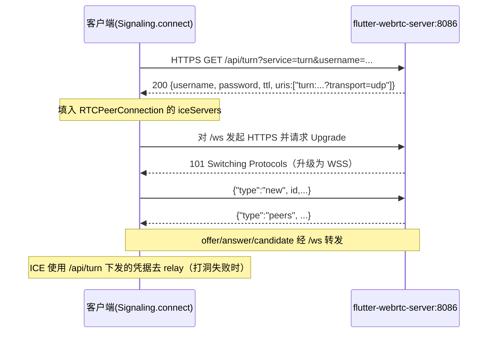
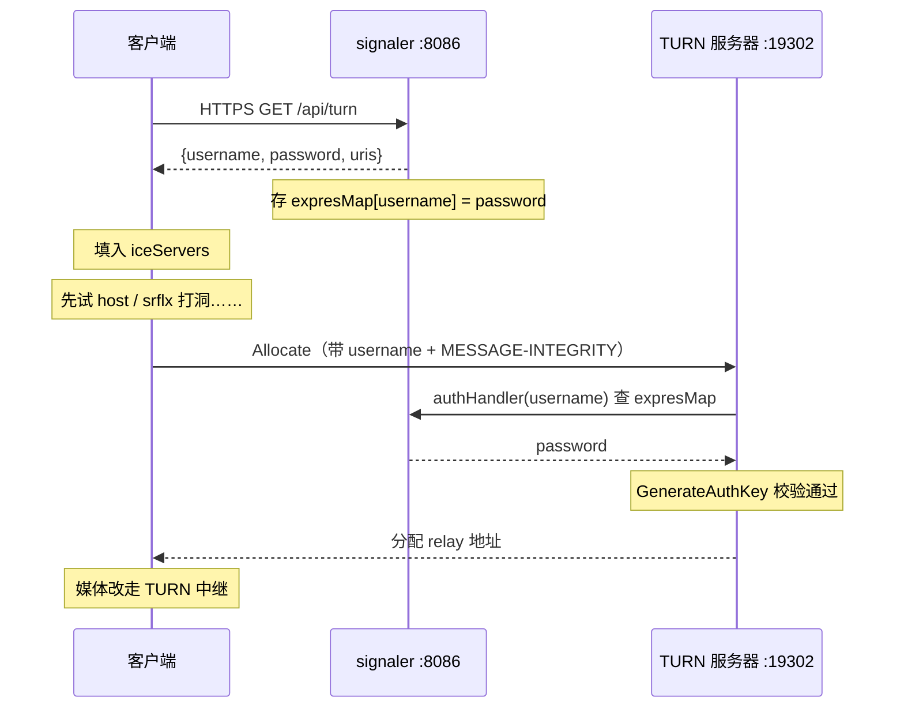
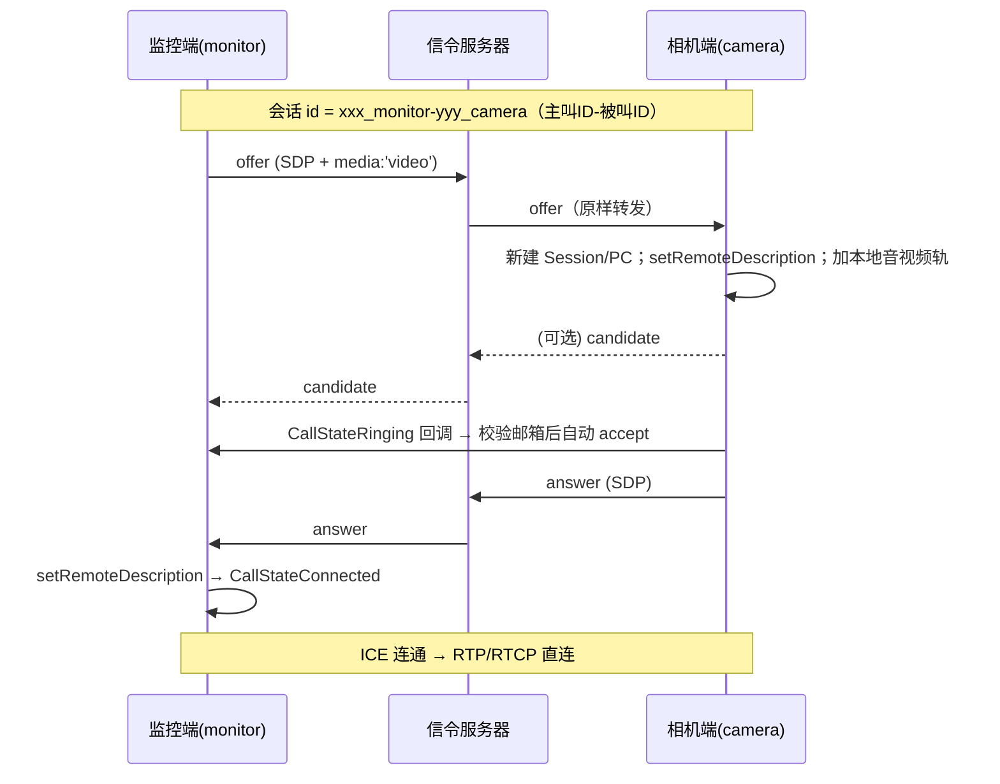
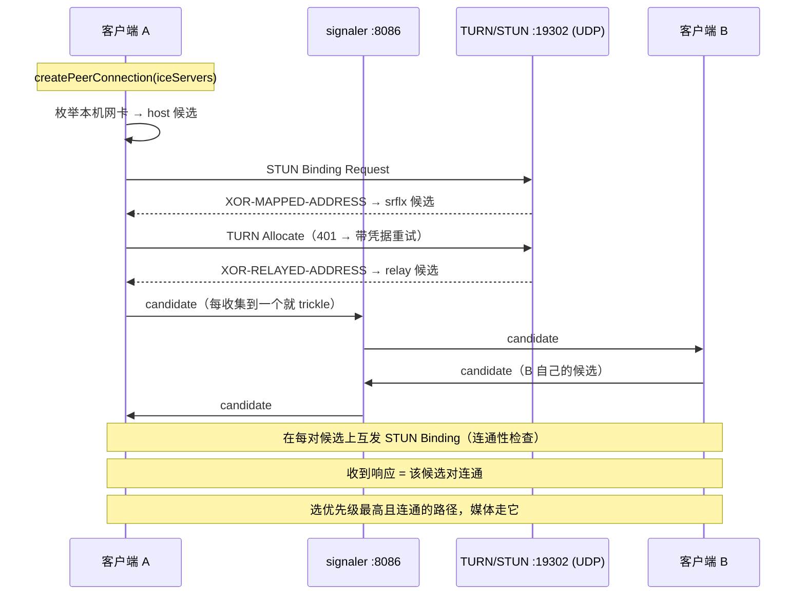

# 04 信令与连接建立

> 状态：🟢 全部填充（4.0–4.6 均已并入；4.4 为概览，逐字节精读见 10 章） ｜ 难度：★★☆☆☆
> 本章要解决的问题：**两个设备怎么通过服务器互相找到、交换能力清单、最终打通 P2P？**

---

## 与现成资料的关系（先读这份，再回来加深）

⚠️ **结论先行版**（本项目连通全链路、含完整时序图）已有一份深度文档：

> 📄 `../监控端WebRTC信令连通逻辑.md`（即 `docs/监控端WebRTC信令连通逻辑.md`）

**2026-11-17 起该文档的核心知识已按主题并入本书**：消息协议 → 本章 4.1；Offer/Answer 与会话建立 → 4.2；服务端实现 → 4.5；完整报文时间线 → 4.6；连接生命周期/心跳重连/异常路径 → `05` 章。原文档保留作为一手完整时序参考，本书作为可检索的知识库。

---

## 4.0 先修：HTTPS vs WSS、本项目两个端点、以及 TURN 到底干什么

> 状态：🟢 已填充
> 对应代码：`flutter-webrtc-server/pkg/websocket/server.go`、`flutter-webrtc-server/pkg/signaler/signaler.go`；客户端 `rephone-security/lib/services/{signaling,websocket,turn}.dart`

新手第一次看到本项目这两个地址时，几乎都会卡在同一个问题：

```text
wss://rephone.top:8086/ws          ← 信令
https://rephone.top:8086/api/turn  ← TURN 凭据
```

一个 `wss://`、一个 `https://`，端口还一样（都是 `8086`），到底什么关系？下面先拆「HTTPS vs WSS」，再拆「这两个地址在 WebRTC 里的分工」。

### 4.0.1 HTTPS 与 WSS 的区别：同一层加密，不同层协议

一句话结论：

> **WSS = WebSocket over TLS，HTTPS = HTTP over TLS。两者共用同一个 TLS 加密底座，区别只在 TLS 之上的「应用层协议」是 WebSocket 还是 HTTP。**

用生活化比喻：

- **TLS（俗称 SSL）** = 一条加密隧道，负责「别人偷看不到、也改不了」。
- **HTTP** = 隧道里跑的「一问一答快递」：客户端提一个请求，服务器回一个响应，然后连接可以关掉。
- **WebSocket** = 隧道里跑的「双向对讲专线」：握手一次后，双方随时都能主动说话，连接一直挂着。

| 对比项 | HTTPS (`https://`) | WSS (`wss://`) |
| --- | --- | --- |
| 全称 | HTTP over TLS | WebSocket over TLS |
| 加密层 | TLS（相同） | TLS（相同） |
| 应用层协议 | HTTP：请求-响应 | WebSocket：全双工长连接 |
| 通信方向 | 基本是「客户端问、服务器答」 | 双方都可以随时主动推消息 |
| 连接寿命 | 通常一次请求/响应就结束 | 建立后长期保持 |
| 握手方式 | TLS 握手 | TLS 握手 + HTTP `Upgrade: websocket` 升级 |
| 典型用途 | 拉一次数据（如取 TURN 凭据、查列表） | 需要服务器主动推送（如信令转发、在线状态） |
| 明文对应物 | `http://` | `ws://` |

> 记忆口诀：**`s` 代表 TLS（加密），前面的 `http` / `ws` 才是「说话方式」。** 所以 `wss://` 和 `https://` 不是「两种安全等级」，而是「同一种安全，两种说话方式」。

#### 一个小坑：代码里写的是 `https://.../ws`，为什么说它是 `wss://`？

看客户端 `rephone-security/lib/services/signaling.dart`（约 493 行）：

```dart
var url = 'https://$_host:$_port/ws';
_socket = SimpleWebSocket(url);
```

再看 `services/websocket.dart` 的 `_connectForSelfSignedCert()`：它**没有**直接用 `WebSocket.connect`，而是自己用 `HttpClient` 发了一个 HTTPS 请求，手动加上：

```dart
request.headers.add('Connection', 'Upgrade');
request.headers.add('Upgrade', 'websocket');
request.headers.add('Sec-WebSocket-Version', '13');
request.headers.add('Sec-WebSocket-Key', key);
```

拿到 `101 Switching Protocols` 后，再用 `WebSocket.fromUpgradedSocket()` 把这条连接「升级」成 WebSocket。

也就是说：**`wss://host/ws` 在协议层等价于「先用 HTTPS 连到 `/ws`，再通过 HTTP Upgrade 升级成 WebSocket」**。本项目为了放行自签证书（`badCertificateCallback = true`）走了手动升级这条路，所以 URL 写成了 `https://`；但语义上它就是 `wss://`。服务端 `pkg/websocket/server.go` 的 `handleWebSocketRequest()` 用 `upgrader.Upgrade()` 完成另一半升级，并由 `http.ListenAndServeTLS()`（即 HTTPS）统一对外提供服务。

### 4.0.2 两个端点在 WebRTC 里的分工

| 地址 | 协议 / 角色 | 干什么 | 何时被调用 | 代码位置 |
| --- | --- | --- | --- | --- |
| `wss://rephone.top:8086/ws` | WebSocket：**信令通道** | 设备注册(`new`)、广播在线名册(`peers`)、转发 `offer/answer/candidate/bye`、心跳 `keepalive` | 建连全程（从建连前到会话结束） | 客户端 `signaling.dart` `connect()`；服务端 `signaler.go` `HandleNewWebSocket()` |
| `https://rephone.top:8086/api/turn` | HTTP：**TURN 凭据签发接口** | 动态签发一组有时效的 TURN 用户名/密码（HMAC-SHA1 计算），供 `RTCPeerConnection` 打洞失败时中继媒体 | 每次 `connect()` 时拉一次（本项目缓存到 `_turnCredential`） | 客户端 `turn.dart` `getTurnCredential()`；服务端 `signaler.go` `HandleTurnServerCredentials()` |

**为什么一个必须用 WSS、另一个用 HTTPS 就够了？**

- 信令是「服务器随时要主动推给你」的场景：相机上线要广播、有人呼叫你要转发 offer……如果只有 HTTPS，客户端得不停轮询，既慢又费。所以信令用**长连接 WSS**。
- 取 TURN 凭据是「问一次拿一次」的场景：拿到 JSON 就完事，不需要长连接，所以用**普通 HTTPS 请求**即可。

**两者如何协作（一次连接建立里的先后顺序）：**



关键点：

1. **`/api/turn` 不参与信令**，它只负责「发钥匙」：客户端拿到 `username/password/uris` 后，塞进 `RTCPeerConnection` 的 `iceServers`（见 `signaling.dart` 约 509–517 行）。
2. **`/ws` 不碰媒体**，它只转发「小纸条」（SDP、ICE 候选）。媒体最终走 ICE 选出的通路；只有直连打不通时，才由 TURN 服务器中继——这正是 `/api/turn` 下发的凭据在起作用。
3. 端口相同（`8086`）只是**同一台服务器复用同一个 TLS 监听**：Go 的 `http.ListenAndServeTLS` 同时承载 `/ws`（升级为 WebSocket）和 `/api/turn`（普通 HTTP）。URL 里 scheme 不同，物理上是同一个 HTTPS 服务。

> 一句话总结：**`/api/turn` 负责「发中继钥匙」（HTTPS，拉一次）；`/ws` 负责「传信令小纸条」（WSS，长连接）。**

### 4.0.3 深挖：TURN 到底干什么？（打不通时的中继兜底）

> 状态：🟢 已填充
> 对应代码：`flutter-webrtc-server/pkg/signaler/signaler.go`、`pkg/turn/turn.go`、`configs/config.ini`；客户端 `rephone-security/lib/services/{turn,signaling}.dart`

**一句话：TURN 是 P2P 打洞失败时的「媒体中继服务器」。**

WebRTC 的理想是两设备**直连（P2P）**，媒体包不经过任何服务器。但现实中设备大多在 NAT/防火墙后面，直连经常失败。这时 TURN 就充当**中转站**：媒体走 `A → TURN → B`，牺牲带宽与延迟，换取「一定能通」。

#### 为什么需要它：NAT 是头号障碍

- 内网设备没有公网地址，外面连不进来。
- **锥形 NAT** 下，STUN 帮双方探到各自的公网映射地址，可以直接打洞（免费）。
- **对称 NAT / 严格企业防火墙**下，打洞失败，只能找一台有公网地址的服务器帮忙转发——这就是 TURN。

#### ICE 的三类候选：relay 是兜底

| 候选类型 | 来源 | 何时能用 | 代价 |
| --- | --- | --- | --- |
| `host` | 本机网卡地址 | 同一局域网 | 免费 |
| `srflx`（STUN） | 通过 STUN 探测到的公网映射地址 | 锥形 NAT，可打洞 | 免费 |
| `relay`（TURN） | TURN 服务器分配的中继地址 | 打洞失败时的**唯一选择** | 媒体过服务器，费带宽、增延迟 |

ICE 按优先级尝试：先 host/srflx，都失败才退化到 relay。所以 **TURN 是「兜底」而非「默认」**。

#### 为什么 TURN 需要「凭据」：防止被白嫖

TURN 是一台公网中继，谁都能连。若不加限制，任何人都能拿它转发流量（盗用带宽、甚至被当代理滥用）。因此业界用 **TURN REST API**（RFC 草案 `draft-uberti-behave-turn-rest`，即 `signaler.go` 注释里的那条链接）签发**短时效凭据**：客户端必须先从应用服务器换取用户名/密码，再拿它去 TURN 服务器开中继。

#### 本项目的完整闭环（签发 → 使用 → 校验）

**第一步：服务端签发（`signaler.go` → `HandleTurnServerCredentials`）**

- 拼用户名：`turnUsername = "时间戳:用户名"`（时间戳让凭据可校验时效、不可长期复用）。
- 算密码：`password = base64(HMAC-SHA1(sharedKey, username))`，`sharedKey` 仅服务端知道。
- 存起来：写进 `expresMap`（TTL 24h），供后续校验。
- 返回：`{username, password, ttl, uris}`。

本项目 `config.ini` 配置 `public_ip=47.251.242.213`、`port=19302`、`realm=flutter-webrtc`，所以下发的 `uris` 实际为 `turn:47.251.242.213:19302?transport=udp`。

**第二步：客户端使用（`signaling.dart` 约 509–517 行）**

拿到 JSON 后填进 `RTCPeerConnection` 的 `iceServers`：

```dart
_iceServers = {
  'iceServers': [
    {
      'urls': _turnCredential['uris'][0],
      'username': _turnCredential['username'],
      'credential': _turnCredential['password']
    },
  ]
};
```

随后 `createPeerConnection` 用它建 PC；ICE 收集候选时就会向 TURN 服务器申请中继地址。

**第三步：TURN 服务器校验（`turn.go` + `signaler.go`）**

打洞失败时，客户端向 TURN 服务器（19302）发 `Allocate`，带上 username 和用 password 算出的 `MESSAGE-INTEGRITY`。pion 调 `HandleAuthenticate` → `signaler.authHandler()` 用 username 查 `expresMap` 拿回 password → `turn.GenerateAuthKey(username, realm, password)` 校验。**校验通过才分配 relay 地址**，媒体从此改走中继。



#### 几个容易踩的点

- **`/api/turn` 只发钥匙，不转发媒体**；真正转发媒体的是 `config.ini` 里 `port=19302` 那个 UDP 监听，两者是不同端口。
- **本项目实际只用 TURN 作为 ICE server**：`signaling.dart` 约 509 行是**重新赋值** `_iceServers`（不是追加），取到凭据后最初那个 `stun:stun.l.google.com` 被覆盖。这没问题——pion 的 TURN 服务器同时应答 STUN Binding 请求，`srflx` 候选仍能从它这里拿到。
- **凭据有时效**：`ttl=86400`（24 小时），`expresMap` 到期即失效，所以不能把用户名密码硬编码进客户端。
- **代价**：一旦走 relay，所有音视频包都过服务器，带宽与延迟显著上升。

> 一句话总结：**TURN = 打洞失败时的媒体中转站；`/api/turn` 发一把 24 小时有效的临时钥匙，客户端拿它去 TURN 服务器（19302）开一条中继通道，让音视频绕道传输。**

---

## 章节内容（4.1–4.6 已填充）

### 4.1 为什么 WebRTC 需要"外部信令"（先立观念）

> 状态：🟢 已填充（2026-11-17）
> 对应代码：客户端 `rephone-security/lib/services/signaling.dart`；服务端 `flutter-webrtc-server/pkg/signaler/signaler.go`

- [x] 规范把"如何找到对端"留给开发者 → 各家自选 WebSocket/HTTP/邮件

WebRTC 标准只定义了「**拿到对端 SDP/候选之后**」的行为；怎么把它们送到对端，规范完全不管。所以每个 WebRTC 应用都要自选信令通道。本项目选 **WebSocket（`/ws`）**，理由见 4.0.2：需要服务器随时主动推送（在线广播、转发 offer），轮询不合适。

- [x] 信令只该传三类消息：会话控制(呼叫/挂断) + 媒体协商(SDP) + 网络协商(ICE 候选)

| 类别 | 作用 | 本项目对应消息 |
| --- | --- | --- |
| 会话控制 | 注册 / 在线名册 / 呼叫挂断 / 保活 | `new` `peers` `bye` `leave` `keepalive` |
| 媒体协商 | 交换 SDP（编解码、方向、ICE 凭据） | `offer` `answer` |
| 网络协商 | 交换 ICE 候选 | `candidate` |

- [x] 对照本项目 9 类消息：`new/peers/offer/answer/candidate/bye/leave/keepalive/error`

所有消息统一 JSON 信封：`{ "type": <string>, "data": <object|array|string> }`。

| type | 方向 | data 关键字段 | 服务端动作 |
| --- | --- | --- | --- |
| `new` | C→S | `{id, name, user_agent}` | 注册进 `peers`；若 id 命中 `camera_device_id` 置 `camera_online=1`；向**所有**在线 peer 广播 `peers` |
| `peers` | S→C | 数组 `[{id,name,user_agent}, ...]` | 每次有人加入/离线，**全量**广播在线列表 |
| `offer` | C→C(S转发) | `{to, from, session_id, media, description:{sdp,type}}` | 查 `peers[to]`，**原样转发**；不存在则回 `error` |
| `answer` | C→C(S转发) | `{to, from, session_id, description}` | 同上 |
| `candidate` | C→C(S转发) | `{to, from, session_id, candidate:{candidate,sdpMid,sdpMLineIndex}}` | 同上（报文细节见 4.3.9） |
| `bye` | C→C(S转发) | `{session_id, from}` | 按 `-` 拆出双方 ID，**向会话双方各发一条 `bye`**（见 4.5） |
| `leave` | S→C | 字符串 peerId | 某 peer 断线时广播给其余在线 peer |
| `keepalive` | C↔S | `{}` | 服务端原样回显（心跳细节见 `05` 章 5.3） |
| `error` | S→C | `{request, reason}` | 目标 peer 不存在 / session 非法时回给发送方 |

> 记忆口诀：**服务端只做「在线簿 + 按 `to` 转发」**——不解析 SDP/候选内容，是无状态信令中继（设计取舍见 4.5）。

配套两条客户端状态枚举（完整状态机见 `05` 章）：

```dart
enum SignalingState { ConnectionOpen, ConnectionClosed, ConnectionError }
enum CallState { CallStateNew, CallStateRinging, CallStateInvite, CallStateConnected, CallStateBye }
```

### 4.2 Offer/Answer 模型（RFC 3264）

> 状态：🟢 已填充（2026-11-17）
> 对应代码：客户端 `rephone-security/lib/services/signaling.dart`（`invite/_createSession/_createOffer/accept/onMessage`）；页面 `camera_endpoint_page.dart`（自动应答）

- [x] JSEP：JS 会话建立协议（为什么 SDP 协商放浏览器里做）

WebRTC 把「**媒体能力长什么样（SDP）**」的生成与消化放在引擎（libwebrtc）里，应用层只负责「传递 + 决定接不接」。这就是 JSEP（JavaScript Session Establishment Protocol）：应用调 `createOffer/createAnswer` 拿 SDP、`setLocal/RemoteDescription` 喂回去，引擎内部推进 `stable → have-local-offer → ...` 的协商状态机。**好处**：应用不用懂 SDP 细节就能协商编解码；**代价**：要改 SDP（如锁 H.264）必须挂在 `setLocalDescription` 前的钩子里（见 `07` 章 P4 的 `_fixSdp`）。

- [x] 主叫生成 offer（含媒体方向），被叫回 answer —— 本项目完整一轮：



两个方向的分工：

| | 监控端（主叫） | 相机端（被叫） |
| --- | --- | --- |
| 采集 | 不采集（`useLocalMedia=false`），offer 里只声明 `OfferToReceiveAudio/Video=true` | 采集本地摄像头/麦克风并 `addTrack` |
| 动作 | `invite()`：建 PC + DataChannel → `createOffer` → 发 offer | 收 offer → `setRemoteDescription` → `accept()`：`createAnswer` → 发 answer |
| 触发 | 收到 `peers` 发现绑定相机在线，延迟 500ms 自动呼叫 | `CallStateRinging` → 校验邮箱 → **自动接听**（或 `reject` 回 bye） |

> ⚠️ 会话 id 约定：`主叫ID-被叫ID`，服务端靠 `-` split 解析双方——**设备 ID 禁止含 `-`**（本项目 `{hash}_camera|monitor` 格式满足，见 `05` 章 5.2）。

- [x] "会话内改媒体"= renegotiation（本项目对讲加麦克风即触发，复用 PC）

同一 `session_id` 的 PC 已存在时再收到 offer，**视为会话内重协商**：只 `setRemoteDescription` + 回 answer，**不重建 PC**。典型场景：监控端开对讲——首次需 `getUserMedia`(mic) + `addTrack` + 重新 `createOffer` 发 offer，相机端走重协商分支直接回 answer；关闭对讲只 mute track，**不再重协商**。

> 排查提示：区分「新会话」（PC 从零建）和「会话内重协商」（复用 PC）——日志里同一 session_id 出现第二轮 offer/answer 属正常，不是重复呼叫。

- [x] 竞赛条件 glare：双方同时发 offer 怎么办（RFC 3264 §5 / RFC 8829 §7.3 perfect negotiation）

**什么是 glare**：两端几乎同时调用 `createOffer` 并 `setLocalDescription`，双方都进入 `have-local-offer` 状态。此时各自又收到对方的 offer，若直接 `setRemoteDescription(offer)`，JSEP 状态机会报错（该状态下只允许收 answer）。结果就是"谁也不让谁"，协商卡死。

**解法：perfect negotiation 的 polite / impolite 双角色**（RFC 8829 §7.3；思路源自 Mozilla 的 Perfect Negotiation 模式）：

- 建 PC 时**两端各分配一个固定且相反的角色**：`polite`（礼貌）与 `impolite`（不礼貌）。角色不能都靠随机，也不能两端相同。
- 收到 offer 时按角色分流：
  - `polite`：若自己也在 offer 中（`have-local-offer`），先执行 **`rollback`**（`setLocalDescription({type: 'rollback'})`，把本地 offer 撤销回 `stable`），再 `setRemoteDescription(offer)` → `createAnswer`。**礼貌端主动让路。**
  - `impolite`：若自己正好在 offer 中，**直接忽略**收到的 offer（不打招呼、不回 error），继续等对方对自己的 offer 回 answer。**不礼貌端死不让路。**
- 因为两端角色相反：glare 时必然是 polite 端回滚、impolite 端坚持，于是只有一条 offer 存活，协商收敛。

三个配套要点（缺一仍会 glare）：

1. **`onnegotiationneeded` 里串行化**：不要在回调里直接 `createOffer`，要用一个标志位/队列避免同一端连续触发多个 offer。
2. **`setLocalDescription` / `setRemoteDescription` 都要 `await`**：glare 判断依赖调用那一刻的 `signalingState`，并发调用会让判断失真。
3. **发送前再校验一次状态**：`await` 之后 signalingState 可能已经被对方回滚改变，需要判断"这个 offer 是不是已经过期"再决定发不发。

> **本项目现状**：目前是**单向主叫模型**——监控端 `invite()` 主动 offer，相机端收到后 `answer`，相机端不会主动 `createOffer`（重协商也由监控端发起），所以**实际不会触发 glare**。这段属于前瞻性知识：一旦未来允许两端都主动改媒体（如双方同时开对讲、同时加流），就必须引入 polite/impolite 角色，否则同一 session_id 上会撞出两个 offer。当前 `onMessage` 里"同一 session_id 收到 offer 就重协商"的分支并没有做角色区分，这是改造时要补的点。

### 4.3 ICE 与候选交换（连接建立的核心难点）

> 状态：🟢 已填充
> 对应代码：客户端 `rephone-security/lib/services/signaling.dart`（`_iceServers` 117–129 / 509–517 行、`createPeerConnection` 641–644 行、`onIceCandidate` 717–737 行、`remoteCandidates` 缓冲 393–398 / 414–419 行）；服务端 `flutter-webrtc-server/pkg/turn/turn.go`、`pkg/signaler/signaler.go`、`configs/config.ini` `[turn]`

**一句话：候选地址不是配置里「给」的，而是 ICE agent 现场「收集」出来的——host 来自本机网卡，srflx 来自 STUN 探测，relay 来自 TURN 分配。**

#### 4.3.1 先破除误解：`iceServers` 是「服务器清单」，不是「候选清单」

很多人第一次看这段代码，会以为 `_iceServers` 里装的就是地址候选：

```dart
RTCPeerConnection pc = await createPeerConnection({
  ..._iceServers,
  ...{'sdpSemantics': sdpSemantics}
}, _config);
```

其实它是 `RTCConfiguration`，只告诉 PC「打洞/中继可以找哪几台服务器帮忙」。真正的候选地址由 PC 内部的 ICE agent 在运行中产生。两者关系：

| | `iceServers`（配置） | ICE 候选（运行时产物） |
| --- | --- | --- |
| 内容 | 服务器 URI + 凭据 | `host` / `srflx` / `relay` 三类（收集产物）+ `prflx`（检查产物） |
| 谁给的 | 开发者（本项目来自 `/api/turn`） | ICE agent 收集产生 |
| 数量 | 通常 1–3 条 | 可能十几条（每种网卡 × 每种类型 × 每个 m= 段） |

**为什么候选会这么多？** 候选数是三个维度的乘积：

1. **网卡数**：Wi-Fi、蜂窝、以太网、虚拟网卡、loopback 各有自己的 IP → 各出一条 host；
2. **候选类型**：每块网卡的 IP 又可派生出 srflx 和 relay（见 4.3.2）；
3. **m= 段数（媒体流数）**：ICE agent 为**每个 media section**（audio / video / data）独立跑一套候选收集。本项目监控端 offer 里用 `OfferToReceiveAudio/Video=true` 声明了 audio 与 video 两条 m= 段（见 4.2），原生层会为每段各收集一组候选——这正是 4.3.9 里 `sdpMid` / `sdpMLineIndex` 必须存在的原因：**候选本体不带"属于哪条流"的信息，一个 PC 有多条流时靠这两个字段归位。**

#### 4.3.2 候选三兄弟（及第四种 prflx）的产生条件

| 候选类型 | 从哪来 | 依赖 `iceServers` | 需要鉴权 | 优先级 |
| --- | --- | --- | --- | --- |
| `host` | **本机网卡枚举**（Wi-Fi / 蜂窝 / 以太网 IP + 随机端口） | ❌ 纯本地 | 否 | 最高 |
| `srflx` | 向 STUN 服务器发 Binding 请求，读回公网映射地址 | ✅ 需 `stun:`（或 TURN，见下） | 否 | 中 |
| `relay` | 向 TURN 服务器发 Allocate，它分配一个中继地址 | ✅ 只有 `turn:` 才有 | ✅ 是 | 最低 |

> **第四种候选 `prflx`（peer-reflexive）**：上表只列了"收集阶段"主动产生的三类。`prflx` 是**连通性检查阶段**才出现的：A 向 B 的某个候选发 STUN Binding Request，如果 B 看到的**源地址**既不是 A 声明的 host、也不是 A 声明的 srflx（典型的对称 NAT 场景，NAT 又开了一个新映射端口），B 就把这个"新看到的地址"记成一条 `typ prflx` 候选。它不经过 STUN 服务器主动探测，而是检查过程的副产物，主要用于**对称 NAT 打洞**——所以 4.3.9 的候选类型列里除了三兄弟还有它。优先级 `type_pref=110`，介于 srflx(100) 与 host(126) 之间，但**它只在本地产生，不会作为候选发给对端**（对端自己也有对称的观察）。

候选字符串长这样（第 3 个数字是优先级，`typ` 是类型）：

```text
candidate:1 1 udp 2130706431 192.168.1.10   54321 typ host
candidate:2 1 udp 1694498815 203.0.113.7    54322 typ srflx raddr 192.168.1.10 rport 54321
candidate:3 1 udp 16777215   47.251.242.213 49152 typ relay raddr 0.0.0.0      rport 0
```

> ⚠️ 注意区分：`srflx` 里的地址是**客户端自己的公网映射地址**（示例中的 `203.0.113.7`），**不是**服务器地址；`relay` 里的地址才是**服务器分配的**（`47.251.242.213:49152`）。

**为什么本项目只配了 TURN，三种候选却依然齐全？** 两个原因：

1. `host` 候选跟 `iceServers` 无关，枚举本机网卡就有；
2. **TURN 协议本身就是 STUN 的扩展，TURN 服务器必须同时应答 STUN Binding 请求**——所以只配 `turn:` 等于同时配了 STUN + TURN，`srflx` 照样能从它这里拿到，只是额外多出了 `relay`。

> 顺带一个隐藏行为：`connect()` 里取 TURN 凭据的 `catch` 是**空的**（`signaling.dart` 518 行）。若 `/api/turn` 请求失败，`_iceServers` 不会被覆盖，会保持初始的 `stun:stun.l.google.com:19302`——即「正常走 TURN 兜底，取凭据失败则退回纯 STUN」的隐式降级。

#### 4.3.3 `turn:47.251.242.213:19302` 到底是谁在和谁通信？

这条 URI 描述的是「**客户端 ↔ TURN/STUN 服务器**」的通信，三个关键事实：

1. **发起方不是 Dart 代码**，而是 flutter-webrtc 的原生层（libwebrtc 的 ICE agent / `BasicPortAllocator`）。Dart 侧只做了「把 `iceServers` 传给 `createPeerConnection`」这一件事，之后完全不参与。
2. **传输层是裸 UDP**，不是 WebSocket/HTTPS——URI 里的 `?transport=udp` 就是这个意思。它**不走 8086**，也**不经过 `/ws` 或 `/api/turn`**。
3. **对端是 TURN 服务器**，与 8086 的 HTTPS 服务是**两个独立监听**：同一台机器，但一个是 `http.ListenAndServeTLS`（8086/TCP），一个是 `net.ListenPacket("udp4", "0.0.0.0:19302")`（19302/UDP，见 `turn.go` 47 行）。

三条通道的分工：

| 通道 | 协议 / 端口 | 谁在用 | 传什么 |
| --- | --- | --- | --- |
| `/api/turn` | HTTPS 8086/TCP | Dart（`turn.dart`） | 取 TURN 用户名/密码（钥匙） |
| `/ws` | WSS 8086/TCP | Dart（`signaling.dart`） | SDP、ICE 候选等信令（小纸条） |
| `turn:...:19302` | STUN/TURN over UDP 19302 | **原生层 libwebrtc** | 探测公网地址、申请中继、中继媒体 |

#### 4.3.4 STUN 探测：怎么问出「我的公网地址」

STUN 报文（RFC 5389）是二进制格式，固定 20 字节头：

```text
 0                   1                   2                   3
 0 1 2 3 4 5 6 7 8 9 0 1 2 3 4 5 6 7 8 9 0 1 2 3 4 5 6 7 8 9 0 1
+-+-+-+-+-+-+-+-+-+-+-+-+-+-+-+-+-+-+-+-+-+-+-+-+-+-+-+-+-+-+-+-+
|0 0|     Message Type          |        Message Length         |
+-+-+-+-+-+-+-+-+-+-+-+-+-+-+-+-+-+-+-+-+-+-+-+-+-+-+-+-+-+-+-+-+
|                    Magic Cookie (0x2112A442)                  |
+-+-+-+-+-+-+-+-+-+-+-+-+-+-+-+-+-+-+-+-+-+-+-+-+-+-+-+-+-+-+-+-+
|                     Transaction ID (96 bits)                  |
+-+-+-+-+-+-+-+-+-+-+-+-+-+-+-+-+-+-+-+-+-+-+-+-+-+-+-+-+-+-+-+-+
```

- `Message Type`：Binding Request = `0x0001`，Binding Success Response = `0x0101`。
- `Magic Cookie`：固定 `0x2112A442`，用来识别「这是 STUN 报文」。
- `Transaction ID`：96 bit 随机数，用于把请求和响应配对。

一次 srflx 探测只有两步：

1. 客户端从某个本地 UDP 端口（比如 `54321`）向 `47.251.242.213:19302` 发一个 **Binding Request**。
2. 服务器不解析内容，只把「它看到的来源地址」（即 NAT 之后的公网映射地址）写进 **`XOR-MAPPED-ADDRESS`** 属性，回一个 Binding Success Response。
3. 客户端解析出来 → 生成一条 `typ srflx` 候选。

> **为什么地址要 XOR 而不直接明文写？** 老式 NAT 的 ALG 会「自作聪明」改写载荷里的 IP 字段，导致地址被改坏。把地址与 Magic Cookie 异或后再塞进属性，ALG 认不出来就不会动它，从而保证拿到的映射地址是真实的。

#### 4.3.5 TURN Allocate：怎么申请一个中继地址（含鉴权）

`relay` 候选比 `srflx` 多一步「申请 + 鉴权」：

1. 客户端向 19302 发 **Allocate Request**（`Message Type = 0x0003`），带 `REQUESTED-TRANSPORT = 17`（UDP 的 IANA 协议号）。
2. 服务器发现没带鉴权信息 → 回 **`401 Unauthorized`**，并附上 `REALM="flutter-webrtc"` 和一次性的 `NONCE`。
3. 客户端用 `/api/turn` 拿到的 username/password 计算：
   - `key = MD5(username ":" realm ":" password)`
   - `MESSAGE-INTEGRITY = HMAC-SHA1(key, 报文内容)`
   然后带 `USERNAME / REALM / NONCE / MESSAGE-INTEGRITY` **重发** Allocate。
4. 服务器校验：pion 调 `HandleAuthenticate`（`turn.go` 73 行）→ `signaler.authHandler()`（`signaler.go` 128 行）用 username 查 `expresMap` 取回 password → `turn.GenerateAuthKey(username, realm, password)` 算出同一个 key → 校验 HMAC。**校验通过才分配。**
5. 服务器回 **Allocate Success Response**（`0x0103`），带：
   - **`XOR-RELAYED-ADDRESS`**：分配给你的中继地址（公网 IP + **一个随机端口**）
   - `XOR-MAPPED-ADDRESS`：顺带告诉你公网映射地址（所以一次 Allocate 也顺便给了 srflx 信息）
   - `LIFETIME`：中继有效期（默认 600 秒），到期前客户端要 Refresh
6. 客户端生成一条 `typ relay` 候选。

> **关键细节：19302 只是控制通道。** `turn.go` 用 `RelayAddressGeneratorStatic{RelayAddress: public_ip, Address: "0.0.0.0"}`——中继用的 UDP socket 绑在 `0.0.0.0` 的**随机端口**上，只把 `public_ip` 宣告给客户端。所以真正的媒体中继走的是另一个端口，不是 19302。

`relay` 候选要真正转发媒体，还差两步（都在 TURN 协议内，对开发者透明）：

- `CreatePermission`：授权某个对端 IP 的数据可以进来（防滥用）。
- `ChannelBind`（或 `Send/Data Indication`）：建立通道，媒体以 `ChannelData` 报文高效转发。

#### 4.3.6 完整 ICE 流程：收集 → 交换 → 检查 → 选路



四步与代码的对应关系：

| 阶段 | 做什么 | 本项目代码 |
| --- | --- | --- |
| 收集 | 产生 host/srflx/relay 候选 | 原生层自动完成 |
| 交换 | 逐个经信令发给对端 | `onIceCandidate` → `_send('candidate', ...)` |
| 检查 | 候选对上互发 STUN Binding | 原生层自动完成 |
| 选路 | 选优先级最高且连通的候选对 | 原生层自动完成 |

#### 4.3.7 trickle ICE 与候选乱序

传统 ICE 要等候选**全部收集完**（可能好几秒）才把完整 SDP 发出去，建连很慢。**trickle ICE** 改成「每收集到一个就立刻发」，不用等——本项目的 `onIceCandidate` 就是这么做的。

代价是**乱序**：候选可能比 offer/answer 先到，此时对端可能还没有 `pc`、或还没 `setRemoteDescription`，直接 `addCandidate` 会失败。本项目用 `Session.remoteCandidates` 做缓冲：

- 收到候选时若 `pc == null`（或还没设远端描述）→ 先存进 `remoteCandidates`；
- `setRemoteDescription` 完成后，把缓冲的候选逐个 `addCandidate` 再清空（`signaling.dart` 393–398、414–419 行）。

**收集的状态机与"结束信号"**：ICE agent 用 `iceGatheringState` 表示收集进度：`new → gathering → complete`。收集是**异步增量**进行的——`host` 纯本地枚举，几乎瞬间完成；`srflx` 要等 STUN 往返；`relay` 更慢（Allocate + 401 鉴权 + 重试，见 4.3.5）。所以"host 先发、relay 后到"是常态，trickle 正是为这种时间差设计的。

当所有候选收集完毕，WebRTC 会给出一个 **end-of-candidates** 信号（API 层通常是 `onIceCandidate` 回调收到一条 `candidate == ''` 的空候选，SDP 层对应 `a=end-of-candidates`），表示"我这边不会再有新候选了"。对端据此可以判断候选是否到齐。本项目 `onIceCandidate`（`signaling.dart` 717–737 行）**没有对该空候选做特殊处理**，仍然是 `candidate` 消息原样转发；对端 `addCandidate(new RTCIceCandidate('', ...))` 在 libwebrtc 里被当作 end-of-candidates 标记消费。这是标准行为，但排查"候选是否收齐"时要知道有这条空消息存在，别以为是异常空包。

> 非 trickle 的旧实现（如早期 SDP 直发）必须等 `gathering → complete` 才把完整候选列表塞进 SDP 一次发出，建连慢；trickle 则边收边发，代价就是前面说的乱序与这里的结束信号语义。

#### 4.3.8 为什么 `onIceCandidate` 发送前 sleep 1 秒

代码注释自己给了答案：

> This delay is needed to allow enough time to try an ICE candidate before skipping to the next one. 1 second is just an heuristic value and should be thoroughly tested in your own environment.

可以理解为一种**粗暴的候选发送节流**：把「瞬间 trickle」变成「每 1 秒放一个」。

- 好处：避免一次性把十几条候选砸给对端，造成信令拥塞或乱序加剧。
- 坏处：候选多时建连明显变慢（N 条 ≈ N 秒）；注释本身也承认这只是 heuristic，需要按实际网络调优。

> 一句话总结：**候选是 ICE agent「收集」出来的（host 来自本机网卡、srflx 来自 STUN 探测、relay 来自 TURN 分配）；`turn:...:19302` 是原生层 libwebrtc 用裸 UDP 直连 TURN/STUN 服务器的通道，和 8086 上的 `/ws`、`/api/turn` 完全是两回事。**

#### 4.3.9 候选报文的格式与转发：发 → 路由 → 收 三跳拆解

> 对应代码：客户端 `signaling.dart` `onIceCandidate` 717–737 行、`onMessage` 的 `case 'candidate'` 438–458 行；服务端 `signaler.go` `case Candidate` 260–283 行

本节回答三个具体问题：**候选报文长什么样？服务端怎么解析它？收到后又怎么还原成候选？**

##### 发的三个字段：候选本体 + 归属信息

`onIceCandidate` 把候选拆成三个字段打包发出：

```dart
'candidate': {
  'sdpMLineIndex': candidate.sdpMLineIndex,
  'sdpMid': candidate.sdpMid,
  'candidate': candidate.candidate,
},
```

| 字段 | 类型 | 含义 |
| --- | --- | --- |
| `candidate` | String | 候选**本体**，就是那一行文本（格式见下） |
| `sdpMid` | String? | 候选属于 SDP 里哪条媒体流（对应 `a=mid:` 的值，如 `"0"` / `"video"`） |
| `sdpMLineIndex` | int? | 同上，只是改用 `m=` 段的**下标**表示（第 0 个 / 第 1 个） |

**为什么必须拆成三个？** 因为候选本体那一行**不包含「属于哪条流」的信息**。一个 PC 可以有多个 `m=` 段（audio / video / data），对方必须知道把它挂到哪条流上，否则会把 video 的候选加到 audio 上。`sdpMid` 与 `sdpMLineIndex` 是等价的两种索引方式。

> 注意：这一跳**并没有解析**——`candidate.candidate` 已经是原生层给出的完整字符串，Dart 只是「拆包」塞进 JSON。真正的解析在 libwebrtc 原生层。

##### candidate 字符串的格式（RFC 5245 §15.1）

空格分隔，**前 8 个字段必填，后 5 个可选**：

```text
candidate:<foundation> <component-id> <transport> <priority> <conn-addr> <port> typ <cand-type> [raddr <rel-addr>] [rport <rel-port>] [extensions]
```

三类候选各举一例：

```text
candidate:1 1 udp 2130706431 192.168.1.10   54321 typ host
candidate:2 1 udp 1694498815 203.0.113.7    54322 typ srflx raddr 192.168.1.10 rport 54321
candidate:3 1 udp 16777215   47.251.242.213 49152 typ relay raddr 0.0.0.0 rport 0 generation 0 ufrag Xy7z network-cost 999
```

逐字段含义：

| # | 字段 | 示例 | 含义 |
| --- | --- | --- | --- |
| 1 | foundation | `1` | 同源候选共享同一个值；用于去重与剪枝（同 foundation 不必重复做连通性检查） |
| 2 | component-id | `1` | `1`=RTP，`2`=RTCP（unified-plan 下基本恒为 1） |
| 3 | transport | `udp` | `udp` 或 `tcp` |
| 4 | priority | `2130706431` | 优先级，**越大越优先**；由类型算出（见下） |
| 5 | conn-addr | `192.168.1.10` | 候选 IP（本机 IP / 公网映射 IP / 中继 IP） |
| 6 | port | `54321` | 候选端口 |
| 7 | `typ` | `typ` | 固定字面量分隔符 |
| 8 | cand-type | `host` | `host` / `srflx` / `prflx` / `relay` |
| 9–12 | `raddr` + rel-addr + `rport` + rel-port | `raddr 192.168.1.10 rport 54321` | 仅 srflx / prflx / relay 有：该候选的「基地址」（relay 场景常为 `0.0.0.0` / `0`） |
| 13 | extensions | `generation 0` | 扩展属性；Chrome 系会带 `generation` / `ufrag` / `network-cost` |

**priority 的计算公式**（RFC 8445 §5.1.2.1）：

```text
priority = 2^24 × type_pref + 2^8 × local_pref + (256 - component_id)
type_pref: host=126, prflx=110, srflx=100, relay=0
```

所以 host 的 priority 恒最大（≈2.13×10⁹），relay 恒最小——「relay 只做兜底」在候选字符串里就体现为这个数字。

##### 服务端：几乎不解析，只认 `to`

```go
var negotiation Negotiation          // 只有 From / To / SessionID 三个字段
err := json.Unmarshal(body, &negotiation)
to := negotiation.To
peer, ok := s.peers[to]
if !ok { /* 回 error：Peer not found */ }
s.Send(peer.conn, request)           // request.Data 是原始 JSON，原样透传
```

两个关键点：

1. `Negotiation` 结构体只有 `From` / `To` / `SessionID`，**根本没有 `candidate` 字段**——服务端不关心候选内容；
2. `request.Data` 是 `*json.RawMessage`（原始 JSON），所以 `candidate` 部分被**原封不动**转发。

此外 `Candidate` 与 `Offer` / `Answer` 走的是**同一个 case**（`case Offer: fallthrough case Answer: fallthrough case Candidate:`），三者共用「取出 `to` → 查 `peers` → 原样转发」这一套逻辑。

这就是**无状态中继**：服务端只做「地址簿 + 转发」，不理解也不校验 SDP/候选语义。好处是简单、易横向扩展；代价是无法做候选过滤、改写或审计。

> 想验证：`signaler.go` 的 `logger.Infof("On message %v", string(message))` 会把原始报文打进日志，能看到完整 JSON。

##### 收端：这里才真正「解析 + 重组」

```dart
var candidateMap = data['candidate'];
RTCIceCandidate candidate = RTCIceCandidate(candidateMap['candidate'],
    candidateMap['sdpMid'], candidateMap['sdpMLineIndex']);
```

把 3 个字段重新拼成 `RTCIceCandidate(candidate, sdpMid, sdpMLineIndex)`（顺序刚好是构造器形参顺序），再交给 `pc.addCandidate()`。之后是乱序缓冲的三个分支：

| 情况 | 处理 | 原因 |
| --- | --- | --- |
| `session != null && session.pc != null` | 直接 `addCandidate` | 正常路径，PC 已建好 |
| `session != null && session.pc == null` | 存入 `remoteCandidates` | PC 还没创建 |
| `session == null` | 新建 Session 并把候选存进去 | **候选比 offer 先到**（极端乱序） |

等 `setRemoteDescription` 完成后统一 flush（`signaling.dart` 393–398、414–419 行，详见 4.3.7）。

##### 这一跳在整体流程中的位置

**一句话：SDP 决定「说什么话」，candidate 决定「走哪条路」——没有候选交换，SDP 协商得再好也连不通。**

| 步骤 | 消息 | 作用 |
| --- | --- | --- |
| 1 | `offer` / `answer`（SDP） | 协商编解码/媒体方向，并交换 ICE 凭据 `a=ice-ufrag` / `a=ice-pwd` / `a=fingerprint` |
| 2 | **`candidate`** | 双方互告「我这边可能能通的地址」——host / srflx / relay |
| 3 | （原生层）连通性检查 | 在「A 的候选 × B 的候选」组成的候选对上互发 STUN Binding |
| 4 | （原生层）选路 | 选「优先级最高且连通」的那一对，媒体走它 |

四个关键点：

- **候选是双向的**：A 发给 B、B 也发给 A；只有双方候选**两两配对**才可能连通。单边全是内网 host 就配不出路径。
- **`ice-ufrag` / `ice-pwd` 是第 3 步的凭据**，它们在 **SDP 里**交换，不在 candidate 消息里。连通性检查的 STUN Binding 用 `USERNAME = 本地ufrag:远端ufrag` + `MESSAGE-INTEGRITY = HMAC-SHA1(ice-pwd, 报文)` 互相认证，防止伪造候选。**这正是收端必须缓冲乱序候选的根本原因**：凭据没到（SDP 还没处理），候选到了也用不了。
- **`sdpMid` / `sdpMLineIndex` 决定候选挂到哪条流**，多 `m=` 段时挂错就整条流连不上。
- **选中的类型决定成本**：host / srflx = 直连（免费）；relay = 走 19302 服务器中继（费带宽、增延迟）。

> 一句话总结：**`onIceCandidate` 把原生层的候选「拆成 3 个字段」；服务端只解析 `to` 再原样转发（无状态中继）；接收端把 3 个字段「重组」成 `RTCIceCandidate` 并用缓冲解决乱序。candidate 消息的作用是把双方的可用路径互通有无，让原生层的连通性检查有的放矢——这是 P2P 能打通的最后一块拼图。**

### 4.4 DTLS 与 SRTP（概览）

> 状态：🟢 已填充概览（2026-11-17），**逐字节精读见 `10` 章 10.6/10.7**。

- [x] 为什么必须先握手再传媒体（防中间人/窃听）：媒体强制加密（SRTP），密钥不能明文过信令 → 用 **DTLS 握手现场协商**：双方各生成临时证书，握手交换并导出 SRTP 主密钥，密钥全程不经过信令。
- [x] 证书指纹如何在 SDP 中交换（`a=fingerprint`）：SDP（经信令）与证书（经 DTLS）两条路分别传递，握手时哈希比对——信令被劫持也有最后防线。
- [x] DTLS 角色 `a=setup: actpass/active/passive`：offer 默认 actpass、answer 定角色；角色选错（实现不完整的端被推到 server）会导致 **ICE 通但媒体不通**——本项目 mbedTLS 踩坑与修法见 `10` 章 10.6.1。

### 4.5 本项目信令转发实现剖析（服务端视角）

> 状态：🟢 已填充（2026-11-17）
> 对应代码：`flutter-webrtc-server/pkg/signaler/signaler.go`、`pkg/websocket/server.go`、`cmd/server/main.go`

- [x] `/ws` 连接与消息循环：`pkg/websocket/server.go` 完成 HTTP `Upgrade` 握手后进入 `signaler.HandleNewWebSocket()`；`conn.On("message")` 循环按 `type` 分发（每条报文都有 `logger.Infof("On message %v", ...)` 日志，抓信令问题直接看服务端日志）。
- [x] 路由只认 `to/from/session_id`：`Offer/Answer/Candidate` 走**同一个 case**（`fallthrough` 串联），逻辑只有三步「解析 `Negotiation`（仅 From/To/SessionID 三字段）→ 查 `peers[to]` → `s.Send(peer.conn, request)` 原样转发」；`request.Data` 是 `json.RawMessage`，SDP/候选内容**零解析零改写**。目标不存在回 `error {request, reason:"Peer not found"}`。
- [x] `bye` 双向通知：`session_id` 按 `-` split 出双方 id，向**两端各发一条 `bye`**——这是「设备 ID 禁止含 `-`」约定的根源。
- [x] `new`/断线 → 全量 `peers` 广播：`NotifyPeersUpdate` 把在线列表发给每一个 peer；WS 断开时先广播 `leave {data: peerId}`、再广播一次全量 `peers`。

服务端核心数据结构（状态模型）：

| 结构 | 内容 | 说明 |
| --- | --- | --- |
| `peers map[string]Peer` | peer id → `{PeerInfo, conn}` | 在线注册表；`new` 加入、连接关闭删除 |
| `expresMap *util.ExpiredMap` | TURN username → 凭据 | TTL 86400s，供 TURN 中继鉴权（见 4.0.3） |
| `sessions map[string]Session` | —— | **未被读写**（历史遗留）：服务端实际**无状态转发**，会话生命周期完全由两端客户端各自维护 |
| `db` | `device_bindings` 表 | `new` 时按 camera id 置 `camera_online=1`；WS 关闭置 0 |

- [x] 无状态中继设计 vs 房间式服务器（各自的取舍）

| | 本项目（无状态中继） | 房间式（如 Janus/rooms） |
| --- | --- | --- |
| 服务端状态 | 只有在线名册 | 房间/会话/成员登记 |
| 媒体路径 | **始终 P2P**（或 TURN 中继） | 可选 SFU 转发 |
| 扩展性 | 简单、易横向扩、零媒体带宽 | 服务端承担媒体算力 |
| 权限控制 | 只能靠两端（相机端 Ringing 时校验邮箱） | 服务端统一鉴权/审计 |

> 设计要点一句话：**服务端不做房间/会话登记，只做「在线簿 + 按 to 路由」，SDP/ICE/DataChannel 一律 P2P。** 相机在线状态是"双通道"的：WS 在线（`peers`，实时强信号）+ DB `camera_online`（弱信号，供列表页展示），两者靠「peer id == camera_device_id」关联。

### 4.6 一次完整呼叫的报文时间线（验证所学）

> 状态：🟢 已填充（2026-11-17）——监控端 ⇄ 相机端视频会话全程，可对照服务端日志逐条验证

报文序列（type 与 4.1 表格一一对应）：

| # | 报文 | 谁发 → 谁收 | 验证点 |
| --- | --- | --- | --- |
| 1 | HTTPS `GET /api/turn` | 监控端 → 服务端 | 拿 `{username,password,ttl,uris}`，填入 `iceServers`（4.0.3） |
| 2 | WSS `/ws` 握手 + `new` | 监控端 → 服务端 | 服务端回 3~4：`peers` 全量列表 |
| 3 | `new` | 相机端 → 服务端 | 命中 camera id → `camera_online=1`，双向收到 `peers` |
| 4 | `offer` | 监控端 → (S) → 相机端 | peers 更新后延迟 500ms 自动呼叫（`05` 章 5.2） |
| 5 | `candidate`（多条） | 双向 → (S) → 对端 | trickle；对端缓冲乱序（4.3.7） |
| 6 | `answer` | 相机端 → (S) → 监控端 | Ringing→校验邮箱→自动 accept；监控端收到即 `CallStateConnected` |
| 7 | （原生层） | 两端直接 | ICE 连通性检查 → 选路 → **媒体走 P2P，不再经过 8086**（4.3.6） |
| 8 | `keepalive` ×N | 双端 ↔ 服务端 | 每 15s，服务端回显（`05` 章 5.3） |
| 9 | `bye` | 任一端 → (S) → 双端 | 服务端按 `-` 拆双方各发一条；收端关 PC 回调 `CallStateBye` |
| 10 | （相机断网时） | S → 其余 peer | `leave` + 全量 `peers`；监控端判定离线退出页面（`05` 章 5.4） |

## 待填充清单
- [x] 4.0 HTTPS vs WSS 区别、本项目 `/ws` 与 `/api/turn` 分工
- [x] 4.0.3 TURN 到底干什么（打洞失败时的中继兜底、凭据签发/使用/校验闭环）
- [x] 4.3 ICE 与候选交换（候选三兄弟 + prflx 来源、STUN/TURN 探测报文、trickle 与乱序缓冲、gathering 状态与结束信号、候选数量三维度、sleep 1s 原因、candidate 报文格式与三跳转发）
- [x] 4.1 信令定位与消息分类（9 类消息协议表、三类消息归属、无状态中继观念）
- [x] 4.2 Offer/Answer/JSEP/renegotiation + glare（polite/impolite perfect negotiation，RFC 8829 §7.3）
- [x] 4.5 服务端实现剖析（消息循环、路由、状态模型、无状态 vs 房间式取舍）
- [x] 4.6 完整报文时间线（监控端呼叫相机端 10 步）
- [x] 4.4 DTLS/SRTP 概览（精读见 `10` 章 10.6/10.7）

## 对应本项目（索引）
- 完整时序文档：`docs/监控端WebRTC信令连通逻辑.md`
- 客户端消息处理：`rephone-security/lib/services/signaling.dart` → `onMessage()`
- 客户端候选回调：`rephone-security/lib/services/signaling.dart` → `onIceCandidate()`（拆包发送，见 4.3.9）
- 服务端路由/转发：`flutter-webrtc-server/pkg/signaler/signaler.go` → `HandleNewWebSocket()`
- 信令端点（WSS）：`wss://rephone.top:8086/ws`；服务端注册见 `pkg/websocket/server.go` → `Bind()`（`WebSocketPath: "/ws"`）
- TURN 凭据端点（HTTPS）：`https://rephone.top:8086/api/turn`；签发见 `pkg/signaler/signaler.go` → `HandleTurnServerCredentials()`
- 客户端取 TURN 凭据：`rephone-security/lib/services/turn.dart` → `getTurnCredential()`（结果填入 `iceServers`，见 `signaling.dart` 约 509–517 行）
- TURN 中继服务器实现：`flutter-webrtc-server/pkg/turn/turn.go` → `NewTurnServer()` / `HandleAuthenticate()`；监听配置见 `configs/config.ini` `[turn]`（`public_ip=47.251.242.213`、`port=19302`、`realm=flutter-webrtc`）
- TURN 凭据校验回调：`pkg/signaler/signaler.go` → `authHandler()`（用 username 查 `expresMap` 取回 password）
