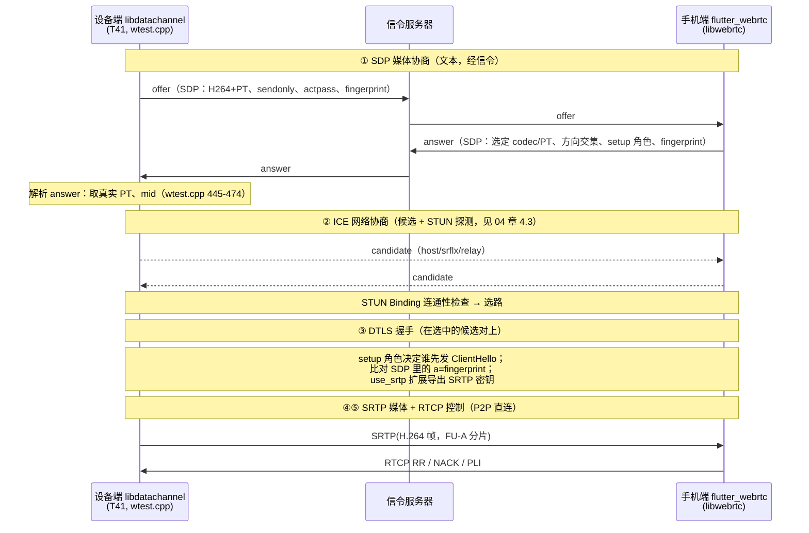
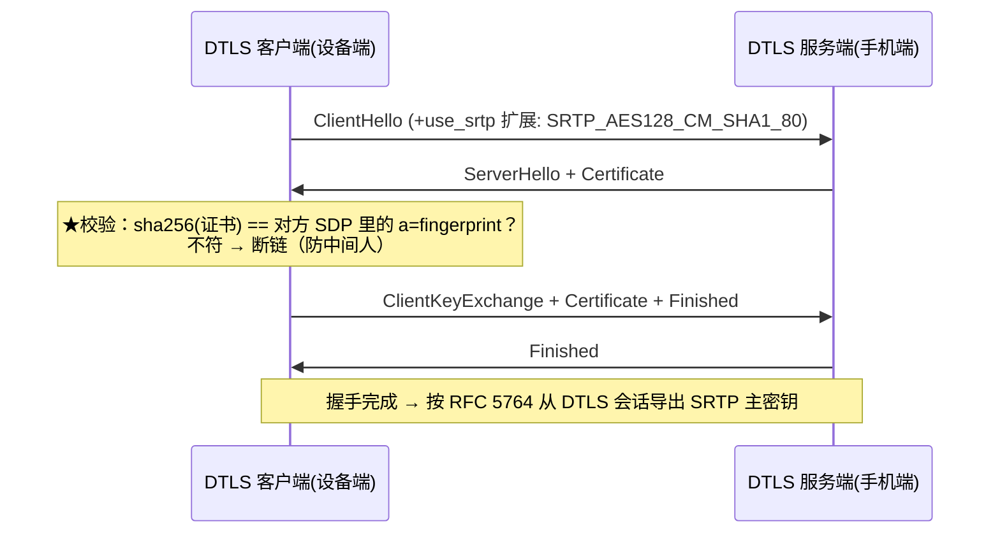

# 10 建链协议精读：SDP → ICE → DTLS → SRTP（双端实现对照）

> 状态：🟢 主体已填充（2026-11-17） ｜ 难度：★★★☆☆
> 本章要解决的问题：**连接建立时双方到底互发了什么字节？各自怎么解析？协商不一致会发生什么？**
> 双端参照：
> - **设备端**（T41 摄像头，C++）：`libdatachannel` 库，代码 `t41-workspace/t41_build/wtest.cpp` 的 `handle_init()`
> - **手机端**（Flutter App）：`flutter_webrtc`（内嵌 libwebrtc），代码 `rephone-security/lib/services/signaling.dart`
> 前置阅读：`04` 章（信令与 ICE 已详述，本章不重复，只补 SDP 侧与加密层）；`03` 章 3.3（SDP 基础）。

---

## 10.0 建链全景：五个阶段的"字节视角"

`04` 章讲的是"消息经信令服务器转发"的**流程**；本章下沉一层，看每个阶段**报文里到底装了什么、对方拿到后怎么解析、哪一步对不上就挂**。

| 阶段 | 协议 / 报文 | 载体 | 双方在交换什么 | 失败后果 |
| --- | --- | --- | --- | --- |
| ① 媒体协商 | **SDP**（offer/answer 文本） | 信令（HTTP/WS） | 编解码清单、方向、传输参数、证书指纹 | 找不到共同 codec → 无媒体；方向冲突 → 单向断流 |
| ② 网络协商 | **ICE 候选**（一行文本）+ **STUN Binding**（二进制 UDP） | 信令 + 直连 UDP | 互告可用地址；在候选对上互相探测 | 全部候选对失败 → `iceConnectionState: failed` |
| ③ 加密协商 | **DTLS 握手**（TLS over UDP） | 直连 UDP | 交换证书、协商 SRTP 密钥 | 指纹不匹配/角色冲突 → ICE 通了但媒体全丢（最迷惑的一类故障） |
| ④ 媒体传输 | **SRTP**（加密的 RTP） | 直连 UDP | 音视频帧 | 解密失败/PT 不符 → 包被静默丢弃 → 黑屏 |
| ⑤ 控制反馈 | **RTCP**（SR/RR/NACK/PLI） | 直连 UDP（与 RTP 同端口复用） | 时钟同步、丢包重传、关键帧请求 | 无 NACK/PLI → 弱网下花屏不恢复 |



> 一句话总纲：**SDP 决定"说什么话"，ICE 决定"走哪条路"，DTLS 决定"用什么钥匙"，SRTP 才是"真正的话"。任何一层对不上，表面症状都可能是"黑屏"，必须分层排查。**

---

## 10.1 SDP 报文逐行精读（以本项目真实报文为例）

SDP 是**纯文本**，`\r\n` 分行，行首一个字母 + `=`。分两段：**会话级**（全局）和**媒体级**（每个 m= 行开启一段）。下面是本项目设备端 answer（libdatachannel 生成）的典型骨架，逐行讲"为什么存在"。

### 10.1.1 会话级部分

```text
v=0
o=- 4611731400430051336 2 IN IP4 127.0.0.1
s=-
t=0 0
a=group:BUNDLE stream-0 stream-1
a=msid-semantic: WMS t41-s0 t41-s1
```

| 行 | 含义 | 为什么需要（背景） |
| --- | --- | --- |
| `v=0` | SDP 协议版本 | 沿用 1998 年的 RFC 4566 格式，永远 0 |
| `o=- <sess-id> <ver> IN IP4 127.0.0.1` | 会话发起者标识：用户名、会话 ID、版本号 | `sess-id` 全局唯一用于区分会话；`ver` 每次 renegotiation 递增（对讲加麦克风时你会看到它 +1） |
| `s=-` | 会话名 | WebRTC 不用，历史遗留必填 |
| `t=0 0` | 会话有效期 | 永久；WebRTC 的会话生命周期由信令层管理 |
| `a=group:BUNDLE stream-0 stream-1` | **多路媒体复用同一条传输通道** | 没有 BUNDLE，每条 m= 行都要独占一组 ICE 候选 + 一次 DTLS 握手；两路视频会消耗双倍端口和握手时间。BUNDLE 让所有 track 走同一个 UDP 五元组 |
| `a=msid-semantic: WMS ...` | 声明本会话用 WMS（WebRTC MediaStream）语义 | 浏览器据此把 `a=msid` 归组到 MediaStream——**msid 重复会导致多路画面串流的根子在這里**（见 10.8 故障 #6） |

### 10.1.2 媒体级部分（每个 track 一段）

```text
m=video 9 UDP/TLS/RTP/SAVPF 96
c=IN IP4 0.0.0.0
a=rtcp:9 IN IP4 0.0.0.0
a=mid:stream-0
a=sendonly
a=rtcp-mux
a=ice-ufrag:4ZcD
a=ice-pwd:2/1mNCikBrcjKhCvbKcW2SLO
a=ice-options:trickle
a=fingerprint:sha-256 8C:71:...:9A
a=setup:actpass
a=rtpmap:96 H264/90000
a=fmtp:96 level-asymmetry-allowed=1;packetization-mode=1;profile-level-id=42e01f
a=rtcp-fb:96 nack
a=rtcp-fb:96 nack pli
a=rtcp-fb:96 goog-remb
a=ssrc:1465206224 cname:t41-main
a=msid:t41-s0 stream-0
```

| 行 | 含义 | 背景与陷阱 |
| --- | --- | --- |
| `m=video 9 UDP/TLS/RTP/SAVPF 96` | 媒体类型、端口、传输协议、**PT 清单** | 端口 `9` 是占位符——真实地址由 ICE 候选决定；`SAVPF` = Secure AV Profile，即"RTP 包会经 DTLS-SRTP 加密"；末尾的数字列表是**本会话所有可用的 payload type** |
| `c=IN IP4 0.0.0.0` | 连接地址 | 同样是占位，真实地址看候选 |
| `a=mid:stream-0` | 本段媒体流的名字 | **BUNDLE 的钥匙**：RTP 包头里带 mid 扩展，接收端靠它把包路由到对应 track；`addIceCandidate` 也必须用正确的 mid（wtest.cpp 433-441 特意从 answer 里解析真实 mid） |
| `a=sendonly` | 媒体方向（我只想发） | 见 10.2.3 方向协商矩阵；WebRTC 四种：`sendrecv/sendonly/recvonly/inactive` |
| `a=rtcp-mux` | RTCP 与 RTP 复用同一端口 | 省一半端口；RFC 5761 |
| `a=ice-ufrag:` / `a=ice-pwd:` | ICE 的用户名片段与密码 | **ICE 层的凭据**：连通性检查的 STUN Binding 报文用它们做 HMAC 认证（04 章 4.3.9）。注意：它防的是"伪造候选"，与媒体加密无关 |
| `a=ice-options:trickle` | 声明支持 trickle ICE | 候选边收集边发，不等齐全（04 章 4.3.7） |
| `a=fingerprint:sha-256 ...` | **本端 DTLS 证书的指纹** | 防中间人的关键：DTLS 握手时对方出示证书，哈希后与此行比对，不符即断（见 10.6.2）。这是 SDP 里唯一"承诺加密身份"的行 |
| `a=setup:actpass` | DTLS 角色提议 | 我两可（active=客户端，passive=服务端），由 answer 定（见 10.6.1；本项目就此踩过坑） |
| `a=rtpmap:96 H264/90000` | PT ↔ 编码映射 | PT 只是会话内编号（96~127 动态分配），**双端各存一张映射表**，RTP 包头里只有数字——这就是"PT 不一致 → 全丢"的原理（见 10.8 故障 #1） |
| `a=fmtp:96 packetization-mode=1;...` | 编码格式参数 | `packetization-mode=1` 允许 FU-A 分片——1080p 一帧几十 KB，一个 UDP 包装不下，必须分片；**mode=0 只允许整 NALU 直装**，选错变体大帧全丢（10.8 故障 #3） |
| `a=rtcp-fb:96 nack / nack pli / goog-remb` | 声明支持的 RTCP 反馈 | `nack`=丢包重传请求、`pli`=关键帧请求、`goog-remb`=带宽估计。**offer/answer 必须双方都声明，接收端才敢用**；设备端不声明 NACK，浏览器就不会发 NACK |
| `a=ssrc:1465206224 cname:t41-main` | RTP 流标识 | SSRC 是 RTP 包头里的 32 位流 ID；cname 用于 SDES/RTCP 关联。接收端校验：**包里的 SSRC 必须和 SDP 声明对得上** |
| `a=msid:t41-s0 stream-0` | MediaStream/Track 归属 | 浏览器据此创建 `MediaStream` 对象并触发 `ontrack` 的 `e.streams` |

### 10.1.3 offer 与 answer 的差异点

同一套行，offer 和 answer 语义不同的只有三处：

| 属性 | offer（设备端发） | answer（手机端回） |
| --- | --- | --- |
| PT 清单 | 列出**全部**支持的 codec | 只保留**协商成功**的（通常是 1 个） |
| 方向 | 提议（如 sendonly） | 取交集后的确定值 |
| `a=setup` | `actpass`（或主动指定） | `active`/`passive` 二选一定死 |

> 本项目实证：设备端 offer 的 `m=video ... 96` 只带 H264 一个 codec（`addH264Codec(VID_PT)`，wtest.cpp 522）；浏览器 answer 里若挑中 H264，会回它**自己重新编号的 PT**——设备端必须以 answer 为准（10.2.4）。

---

## 10.2 offer/answer 协商算法：双方怎么"对齐"

RFC 3264 规则（03 章 3.3.3 已有基础版）这里讲 **JSEP/unified-plan 层的实现机制**和"不满足会怎样"。

### 10.2.1 三条铁律

1. **answer 不能引入 offer 里没有的东西**：codec、PT 值、fmtp 参数、rtcp-fb，都只能从 offer 清单里**挑**。设备端只发 H264 → 手机端哪怕更喜欢 VP8 也只能接受 H264（或拒答）。
2. **answer 每条 m= 段必须有明确归宿**：接受（保留）、拒绝（`m=video 0 ...`，端口 0）、或置零方向（`a=inactive`）。不允许"悬空"。
3. **最终生效 = answer 里的内容**。offer 只是提案，answer 是合同。

### 10.2.2 unified-plan 与 transceiver：手机端的协商账本

libwebrtc 内部为每条 m= 行维护一个 **RTCRtpTransceiver**（收发器），它记录：

```text
Transceiver {
  mid: "stream-0"                  ← 关联到 SDP 的哪一段
  direction: sendonly/recvonly/... ← 当前方向
  sender:   { track, ... }         ← 发送侧（手机端用 replaceTrack 换轨的地方，07 章 P5）
  receiver: { track }              ← 接收侧（ontrack 回调的来源）
}
```

`addTrack()` = 找一个方向兼容的 transceiver 绑定 sender；`onTrack` = 对端媒体经 transceiver.receiver 吐出来。**plan-b（旧语义，多 track 挤一个 m= 段）已废弃**——两端实现不一致时（一端 plan-b 一端 unified-plan）会出现"第二条视频轨静默丢失"。本项目两端都是 unified-plan（flutter_webrtc 的 `sdpSemantics` 参数，`09` 章 9.10 详述过 addTrack 穿透链）。

### 10.2.3 方向协商矩阵（RFC 3264 §6.1）

| offer 提议 | answer 回应 | **实际生效**（对双方） |
| --- | --- | --- |
| sendrecv | sendrecv | 双向 |
| sendrecv | sendonly | answer→offer 单向（offer 只收） |
| sendrecv | recvonly | offer→answer 单向（offer 只发） |
| sendrecv | inactive | 停 |
| **sendonly** | recvonly | offer→answer 单向 ★本项目 |
| sendonly | sendonly | ❌ 非法，answer 必须回 recvonly 或 inactive |
| sendonly | inactive | 停 |

> 本项目实证：设备端 `Direction::SendOnly`（wtest.cpp 521）→ 手机端 answer 必回 `a=recvonly`。如果手机端页面把 track 方向配错（比如相机端也回 sendonly），协商非法，媒体建立失败。

### 10.2.4 PT 的"重新编号"陷阱 ★本项目核心踩坑

**背景**：PT（payload type）0~95 是静态约定（如 0=PCMU），96~127 动态分配、**只在单次会话内有效**。两端各自生成 SDP 时，编号互不相通——offer 里的 `96` 和 answer 里的 `96` 不一定指同一个 codec。

**规则**：RTP 包头里的 PT 数字，必须按 **answer**（合同）解释。发送方发的每个包，PT 都要填 answer 里对应自己编码格式的那个号。

**本项目实证**（wtest.cpp 445-474）：设备端把包化器初始 PT 设为 96，但收到浏览器 answer 后**重新解析 answer 全文**，找出 H264 实际被分到的 PT（Safari 的 offer/answer 里有多个 H264 变体，还要挑 `packetization-mode=1` 的那个），再回写 `g_rtpcfg[i]->payloadType`：

```cpp
/* 关键：协商以 offer 为准，H264 的实际 payload type 要从 answer 里取。
   Safari 的 offer 里有多个 H264 变体（mode=0 / mode=1），必须选
   fmtp 带 packetization-mode=1 的那个，否则 FU-A 分片会被全部丢弃 */
int chosen = pt_mode1 >= 0 ? pt_mode1 : pt_any;
if (chosen > 0 && chosen < 128) {
    for (int i = 0; i < NTRACK; i++)
        if (g_rtpcfg[i]) g_rtpcfg[i]->payloadType = (uint8_t)chosen;
}
```

> 若跳过这一步：设备发的 RTP 包 PT=96，而 answer 里 96 实际是 VP8（或另一个 H264 变体）→ 浏览器查表分派给错误的解码器/直接丢弃 → **ICE 正常、DTLS 正常、却永远黑屏**。这是"网络全通但不解码"类故障的头号原因。

---

## 10.3 设备端（libdatachannel）建链步骤分解

对照 `wtest.cpp handle_init()`（420-556 行），每一步背后库替你做了什么：

| 代码 | libdatachannel 内部行为 |
| --- | --- |
| `rtc::Configuration cfg` | 空配置 = 只有 host 候选。设备在局域网内直连浏览器，不需要 STUN/TURN（04 章 4.3 的 srflx/relay 在此场景用不上） |
| `new rtc::PeerConnection(cfg)` | 生成 ICE agent；**生成自签名 DTLS 证书**（后续写进 `a=fingerprint`） |
| `Description::Video(mid, SendOnly)` + `addH264Codec(96)` | 构造 SDP 的 m= 段：方向 sendonly、PT 96 绑 H264/90000 |
| `video.addSSRC(ssrc, cname, msid, mid)` | 写 `a=ssrc` / `a=msid` 行——**每路 track 的 msid 必须不同**，否则浏览器归并成一条流（10.8 故障 #6） |
| `pc->addTrack(video)` | 注册发送轨；返回的 Track 上挂 media handler 链 |
| `H264RtpPacketizer + RtcpSrReporter + RtcpNackResponder` | 出向媒体处理链（见 10.7.2）：H264 帧 → RTP 打包 → 周期发 RTCP SR → 应答 NACK |
| `pc->setLocalDescription()` | **生成 offer**：填 ice-ufrag/pwd、fingerprint、`a=setup:actpass`（默认）；触发 ICE 收集 → `onLocalCandidate` 逐个回调 |
| `onLocalDescription` → HTTP 返回给浏览器 | 设备端自己当 HTTP 信令服务器（:8080 `/offer`） |
| `pc->setRemoteDescription(answer)` | 解析 answer：确定 PT 映射、方向、DTLS 角色；ICE 有了对端候选即可开始连通性检查 |
| answer 到达 → ICE connected → DTLS 握手 → track open | `track->isOpen()` 才允许 `send()`（send_to 里判空保护） |

### 10.3.1 设备端独有的"SDP 后处理"（无浏览器 API 时的人工干预）

浏览器/Flutter 端这些事由引擎自动完成，设备端裸用 libdatachannel 则要**手写两段 SDP 补丁**（wtest.cpp 543-553）：

1. **PT 回填**：从 answer 解析真实 H264 PT 覆盖本地包化器（10.2.4）。
2. **setup 角色改写**：把 offer 里的 `actpass` 替换成 `active`（原因见 10.6.1 踩坑）。

> 这两段代码就是"协商不一致"的活教材——它们各自对应一类真实故障。

---

## 10.4 手机端（flutter_webrtc / libwebrtc）建链步骤分解

对照 `signaling.dart`，同样的事在手机端的样子（Dart API → 引擎行为）：

| Dart 代码 | libwebrtc 内部行为 |
| --- | --- |
| `createPeerConnection({..._iceServers, sdpSemantics})` | 建 ICE agent + DTLS 上下文；iceServers 决定 srflx/relay 候选的来源（04 章 4.3） |
| `createDataChannel('fileTransfer')` | 主叫先建 DC；SDP 里随之多一条 `m=application` 段（BUNDLE 一起复用传输） |
| `pc.addTrack(track, stream)`（相机端） / 仅声明 `OfferToReceive`（监控端） | 绑 transceiver.sender；监控端 offer 里是 `a=recvonly` |
| `pc.onTrack = ...` | 收端：answer 生效、媒体包到达后，引擎经 transceiver.receiver 吐出 track → UI 渲染（08 章） |
| `await pc.createOffer()` | 引擎汇总所有 transceiver → 生成 SDP offer（含全部 codec 清单、按优先级排序——**这就是 P4 里 VP8 排在 H264 前面的来源**，07 章 P4） |
| `setLocalDescription(offer)` → `_send('offer')` | 应用层把 SDP 经信令发出 |
| 收 answer → `setRemoteDescription(answer)` | 引擎按合同更新 transceiver/PT 表/DTLS 角色；**缓冲的候选此时统一补加**（04 章 4.3.7） |
| `onIceCandidate` → 1s 节流发送 | trickle 逐条发候选（04 章 4.3.8） |

### 10.4.1 两端 API 对照表（同一件事的两种写法）

| 职责 | 设备端 libdatachannel | 手机端 flutter_webrtc |
| --- | --- | --- |
| 建 PC | `new rtc::PeerConnection(cfg)` | `createPeerConnection(map)` |
| 声明媒体 | `Description::Video(mid, SendOnly)` + `addTrack` | `addTrack(track)`（方向随 transceiver）/ offer 约束 |
| 生成 offer | `setLocalDescription()` 后读 `onLocalDescription` | `createOffer()` + `setLocalDescription()` |
| 吃 answer | `setRemoteDescription(Description(sdp,"answer"))` | `setRemoteDescription(RTCSessionDescription)` |
| 候选回调 | `onLocalCandidate` | `onIceCandidate` |
| 候选注入 | `addRemoteCandidate(Candidate)` | `addCandidate(RTCIceCandidate)` |
| 打包发送 | 手动组链：`H264RtpPacketizer→SrReporter→NackResponder`，`track->send(frame)` | **全自动**：引擎内部打包/加密/自适应码率，`addTrack` 后不再操心 |
| 观测 | 自己打日志（`[pc] state=/ice=`） | `onIceConnectionState` / `getStats` / `chrome://webrtc-internals` |

> 结构性差异：libdatachannel 把媒体处理链**交给应用组装**（灵活但要自己踩 PT/msid/分片这些坑——本章一半的故障案例来自这里）；libwebrtc 全部封装（省心但黑盒，调优只能靠 SDP 改写钩子 `_fixSdp`，07 章 P4）。

---

## 10.5 ICE 在 SDP 中的落点（衔接 04 章）

04 章 4.3 已详述候选的产生（host/srflx/relay）与探测（STUN Binding 报文格式）；这里只补**协议层面与 SDP 的耦合点**：

| 耦合点 | 内容 | 对不上的后果 |
| --- | --- | --- |
| `a=ice-ufrag/pwd` | 双方各自的检查凭据，**写在 SDP 里**随 offer/answer 交换 | 用错对端的 pwd → STUN Binding 的 MESSAGE-INTEGRITY 校验失败 → 所有候选对判死 |
| `a=candidate:` 行 | 非 trickle 模式候选直接写在 SDP 里；trickle 模式 SDP 只留空、候选走信令逐条发 | 混用两种模式 + 乱序 → 候选丢失（两端都有缓冲保护，04 章 4.3.7） |
| `a=end-of-candidates` | 声明候选收集完毕 | 接收端等不到它可能延长建连 |
| `a=mid` | 每个 candidate 消息带 `sdpMid/sdpMLineIndex`，指明候选属于哪条媒体流 | **BUNDLE 下挂错 mid → 候选加到错误的传输通道**（wtest 特意解析 answer 的真实 mid 回传浏览器，wtest.cpp 433-441） |

---

## 10.6 DTLS 握手：加密通道怎么建立

### 10.6.1 背景：为什么媒体必须加密 + 为什么角色会出问题

**背景一（为什么加密）**：WebRTC 强制媒体加密（SRTP），明文 RTP 一律不收。密钥不能明文传（信令服务器看得见），于是用 **DTLS 握手现场协商**——双方各自生成临时证书，握手交换，密钥从不经过网络明文。

**背景二（角色协商，RFC 5763）**：DTLS 有客户端/服务端之分（谁先发 ClientHello）。SDP 用 `a=setup` 协商：

| offer 里 | answer 里 | 谁是 DTLS 客户端（先握手） |
| --- | --- | --- |
| `actpass`（默认） | `active` | **answerer** |
| `actpass` | `passive` | **offerer** |

**★本项目踩坑实证**（wtest.cpp 543-553）：设备端 offer 默认 `actpass` → 浏览器答 `active` → **设备被推到 DTLS server 角色** → 设备的 mbedTLS 后端在 server 模式握手失败。修法：设备把 offer 里的 `actpass` 字符串替换为 `active`，浏览器只能答 `passive`，设备保持 client（此前已验证可用的角色）：

```cpp
/* 关键：offer 默认 a=setup:actpass → Chrome 会答 setup:active，
   设备被推到 DTLS server 角色 → mbedTLS 后端握手失败。
   改为 a=setup:active，Chrome 只能答 setup:passive，设备保持 DTLS client */
size_t sp = g_answer.find("a=setup:actpass");
if (sp != std::string::npos) {
    g_answer.replace(sp, strlen("a=setup:actpass"), "a=setup:active");
}
```

> 排查启示：**ICE 状态 connected 但媒体不通**，第一件事看 DTLS 角色——两端实现（mbedTLS/OpenSSL/BoringSSL）对 server/client 模式的支持完整度不同，角色不是随便定的。

### 10.6.2 握手流程与指纹校验



三个要点：

1. **use_srtp 扩展**（RFC 5764）：ClientHello 里声明"我要用这个 DTLS 会话跑 SRTP"，并给出保护套件（如 `SRTP_AES128_CM_SHA1_80`）。两端套件集合无交集 → 握手失败。
2. **指纹校验**：证书哈希必须等于对方 SDP 的 `a=fingerprint`。SDP 经信令传（信令通道本身用 TLS 保护），证书经 DTLS 传——两条路对上了才排除中间人。**信令被劫持但指纹校验仍在**是这条设计的最后防线。
3. **密钥导出**：握手完成后，双方用 DTLS exporter 按 `client-write-key/server-write-key` 分工导出 SRTP 主密钥——客户端握手材料导出的密钥用于"客户端→服务端"方向，反之亦然。密钥全程不落信令。

### 10.6.3 DTLS 失败的表现（对照 05 章状态机）

| 现象 | 层面 | 特征 |
| --- | --- | --- |
| `iceConnectionState: connected` 但无媒体 | DTLS 挂了 | 最迷惑：网络层一切正常 |
| 指纹不匹配 | 校验失败 | 握手在 Certificate 后断 |
| 角色/套件不兼容 | 握手协议错 | ClientHello 无响应或直接 alert |

---

## 10.7 SRTP：媒体包怎么加密与打包

### 10.7.1 RTP 包头（12 字节，明文保留）

```text
 0                   1                   2                   3
 0 1 2 3 4 5 6 7 8 9 0 1 2 3 4 5 6 7 8 9 0 1 2 3 4 5 6 7 8 9 0 1
+-+-+-+-+-+-+-+-+-+-+-+-+-+-+-+-+-+-+-+-+-+-+-+-+-+-+-+-+-+-+-+-+
|V=2|P|X|  CC   |M|     PT      |       sequence number         |
+-+-+-+-+-+-+-+-+-+-+-+-+-+-+-+-+-+-+-+-+-+-+-+-+-+-+-+-+-+-+-+-+
|                           timestamp                           |
+-+-+-+-+-+-+-+-+-+-+-+-+-+-+-+-+-+-+-+-+-+-+-+-+-+-+-+-+-+-+-+-+
|                             SSRC                              |
+-+-+-+-+-+-+-+-+-+-+-+-+-+-+-+-+-+-+-+-+-+-+-+-+-+-+-+-+-+-+-+-+
```

| 字段 | 位数 | 本项目对应 |
| --- | --- | --- |
| PT | 7 | **answer 协商出的 H264 PT**（10.2.4 回填的那个） |
| sequence number | 16 | 逐包 +1；NACK 重传靠它定位 |
| timestamp | 32 | 90kHz 时钟；设备端 `ts = pack.timestamp * 90 / 1000`（毫秒→90k，wtest.cpp 602） |
| SSRC | 32 | 设备端写死 `0x57455350+i`（"WEST"+i），与 SDP 的 `a=ssrc` 一致 |

SRTP 包 = **RTP 头（明文）+ 加密的 payload + 8~12 字节认证 tag**。密钥来自 10.6 的 DTLS 导出；认证失败或密钥不符 → 包被静默丢弃（不报错，就是"没画面"）。

### 10.7.2 H.264 怎么装进 RTP（RFC 6184）★本项目核心

一帧 1080p H.264 可达几十 KB，而 UDP 包实际载荷一般 ≤1400 字节 → **必须分片**。RFC 6184 定义三种打包方式：

| 方式 | 适用 | 本项目关联 |
| --- | --- | --- |
| Single NALU | 一个 NALU ≤ 一包（小帧/参数集） | SPS/PPS 这类小单元 |
| STAP-A | 多个小 NALU 聚合一包 | 帧头的小参数集合并 |
| **FU-A** | 大 NALU 切成多包，共享同一 timestamp/seq 连续 | **1080p 视频帧的主力路径** |

**`packetization-mode` 就是"允许用哪些方式"的开关**：mode=0 只允许 Single NALU + STAP-A（**没有 FU-A**）；mode=1 才允许 FU-A。这就是 wtest 从 answer 的多个 H264 变体里**必须挑 mode=1** 的原因（10.2.4）——选了 mode=0 的变体，分片帧全被解码端拒绝。

**为什么设备端要 `LongStartSequence` 分隔符**：IMP 编码器输出的 Annex-B 码流用 `00 00 00 01` 起始码分隔 NALU；包化器要按它切分再重组（wtest.cpp 530-531）。浏览器端解码器期望的是"去起始码、按 RTP 载荷格式重组"——这条转换就在 `H264RtpPacketizer` 内部完成。

### 10.7.3 media handler 链：设备端的出向管线

```text
track->send(h264_frame)
  → H264RtpPacketizer      切 NALU / FU-A 分片，填 PT/seq/timestamp/SSRC
  → RtcpSrReporter         周期发 RTCP SR（NTP↔RTP 时钟配对，音画同步用，03 章 3.4.8）
  → RtcpNackResponder      收到 NACK → 从缓存重发对应 seq 的包
  → (库内部) SRTP 加密 → UDP 发出
```

> 对比：手机端 libwebrtc 把这整条链（含码率自适应、FEC、jitter buffer）都内置了；设备端裸库只给了骨架，**丢包恢复能力取决于你挂没挂 NACK responder**。没挂 → 弱网丢包后等下一个 IDR 才能恢复（花屏直到关键帧）。

---

## 10.8 协商不一致故障大全（本项目实证优先）

按建链顺序排列，★ = 本项目真实踩过。

| # | 故障 | 协议层原因 | 表面现象 | 本项目实例 / 修法 |
| --- | --- | --- | --- | --- |
| 1 | **PT 不一致** ★ | RTP 包头 PT 数字与 answer 映射表不符 | ICE/DTLS 全通，包静默丢弃 → 黑屏 | wtest 初始 PT=96，answer 可能重编号 → **必须解析 answer 回填**（10.2.4） |
| 2 | **codec 不在 offer 里** | answer 不能引入新 codec（10.2.1 铁律 1） | 协商直接失败或降级到不想要的编码 | 设备端 offer 只带 H264 → 手机端被迫收 H264；反之手机端 offer 若 VP8 优先且对端只回 VP8 → 软编发热（07 章 P4 同源问题） |
| 3 | **H264 变体选错** ★ | 同一 codec 多个 fmtp 变体（mode=0/1），PT 各自独立 | 大帧全丢、小帧偶尔能出 → 花屏/黑屏交替 | Safari offer 双变体 → 挑 `packetization-mode=1`（wtest 445-474） |
| 4 | **profile-level-id 过低** | offer 只含低 level（如 42e01f=3.1，最高 720p@30） | 高分辨率协商失败或解码异常 | 1080p 需要 level ≥3.1；`level-asymmetry-allowed=1` 可缓解，但两端参数集要兼容 |
| 5 | **DTLS 角色冲突** ★ | actpass 让实现不完整的端当 server | ICE connected 但媒体不通 | mbedTLS server 握手失败 → offer 改 `setup:active`（10.6.1） |
| 6 | **msid 重复** ★ | 多条 track 声明同一 msid | 浏览器把多轨归并进一个 MediaStream，所有 `<video>` 渲染第一轨 → **多路画面全一样** | V10 修复：每 track 独立 `t41-s0/s1/s2` + 页面用单轨 `new MediaStream([e.track])` |
| 7 | **mid 用错** ★ | BUNDLE 下 candidate/RTP 按 mid 路由 | 候选加错通道 / 媒体进错 track | 浏览器 `addIceCandidate` 必须用 **answer 里的真实 mid**（wtest 解析回传，433-441） |
| 8 | **方向冲突** | sendonly 配 sendonly 等非法组合（10.2.3） | 协商失败或单向断流 | 设备 SendOnly ↔ 手机必须 recvonly |
| 9 | **plan-b vs unified-plan** | 两侧语义不同，第二条视频轨静默丢失 | 第一路正常、第二路永远不出 | 两端统一 unified-plan（`09` 章 9.10） |
| 10 | **指纹不匹配 / 套件无交集** | DTLS 校验失败 | ice connected → 秒断，反复 | 检查两端 TLS 后端支持的 SRTP 套件；证书生成时间（时钟偏差影响有效期） |
| 11 | **rtcp-fb 未声明** | SDP 没写 `a=rtcp-fb`，接收端不敢发 NACK/PLI | 弱网花屏不恢复、黑屏后无法请求关键帧 | libdatachannel 默认声明 nack/pli；自己改 SDP 时别删 |
| 12 | **时钟率不符** | rtpmap 声明 90000 但包时间戳按别的频率填 | 画面播放速度异常/音画不同步 | 视频恒 90kHz：`ts = ms * 90`（wtest 602） |

> **故障的共同形态**：②③④ 层失败的表现高度相似（都是"连上了但没画面"）。排查顺序固定：先 `iceConnectionState`（网络层）→ DTLS 日志（加密层）→ **answer 里的 PT/fmtp 与实际 RTP 包比对**（协商层）→ msid/mid（归组层）。设备端 wtest 的 `[answer]` 日志专门打印这些行就是为了这步。

---

## 10.9 排查工具箱：怎么"看到"这些协议字节

| 工具 | 看什么 | 用法 |
| --- | --- | --- |
| 设备端日志 `/data/wtest.log` | `[answer]` 打印的 m=/rtpmap/fmtp/ssrc 行、`[pc] state/ice` | 排查协商层第一入口 |
| `/data/offer.sdp` | 设备端最后一次完整 SDP | 与手机端收到的对比 |
| 服务端 `On message` 日志 | offer/answer/candidate 全文 | 信令层看到的就是两端收到的（无状态转发，04 章 4.5） |
| `chrome://webrtc-internals` | 两端 SDP、getStats（PT/编解码/丢包/码率）、ICE 候选对 | 浏览器侧一切协商结果的权威视图 |
| `getRtpSenderCapabilities('video')` | 手机端能力全集 | 07 章 P4 的验证手段 |
| Wireshark（`stun || dtls || udp.port==19302`） | STUN Binding / DTLS 握手原文；SRTP 只能看到加密包 | 验证 04 章 4.3.4-4.3.5 的报文格式 |

---

## 待填充清单
- [x] 10.0 建链五阶段字节视角总览
- [x] 10.1 SDP 逐行精读（会话级/媒体级/offer-answer 差异）
- [x] 10.2 协商算法（三铁律/transceiver/方向矩阵/PT 重编号陷阱）
- [x] 10.3 设备端 libdatachannel 步骤分解 + SDP 后处理
- [x] 10.4 手机端 flutter_webrtc 分解 + 双端 API 对照
- [x] 10.5 ICE 与 SDP 的耦合点
- [x] 10.6 DTLS（背景/角色/setup 踩坑/指纹/密钥导出）
- [x] 10.7 SRTP（RTP 头/H264 打包/FU-A/media handler 链）
- [x] 10.8 协商不一致故障大全（12 类）
- [x] 10.9 排查工具箱
- [ ] 10.6.3 补一次真实 DTLS 失败的日志样例
- [ ] 10.7 补 Wireshark 抓包样例（STUN/DTLS 各一段）

## 对应本项目（索引）
- 设备端建链全代码：`t41-workspace/t41_build/wtest.cpp` → `handle_init()`（420-556 行）
- answer 解析/PT 回填：同上 445-474 行；setup 角色改写：543-553 行
- 媒体发送链：`send_to()`（560-572）+ `stream_thread()`（577 起）
- 手机端信令与 PC：`rephone-security/lib/services/signaling.dart`（对照表见 10.4.1）
- 协议规范：RFC 4566 (SDP)、RFC 3264 (offer/answer)、RFC 8829 (JSEP)、RFC 8445 (ICE)、RFC 5763/4145 (DTLS 角色)、RFC 5764 (DTLS-SRTP)、RFC 3711 (SRTP)、RFC 6184 (H.264 RTP)、RFC 8843 (BUNDLE)
- 关联章节：04（信令与 ICE 细节）、03 §3.3/§3.4（SDP/RTP 基础）、07 P1/P4/P5（关联踩坑）、08（渲染端消费）
